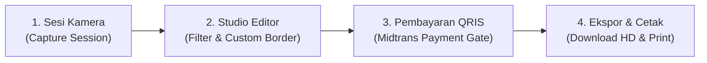

# 📸 Qxuan Photobooth

> **Modern, Minimalist & Production-Ready Self-Photo Studio Web Application.**  
> Dirancang dengan standar estetika studio bersih (*clean aesthetic*), pemrosesan grafis HTML5 Canvas beresolusi tinggi (HD 300 DPI), gerbang pembayaran otomatis **QRIS Dinamis**, serta penyimpanan awan sementara berbasis **Supabase (PostgreSQL & Storage)** dengan protokol privasi **Auto-Delete 24 Jam**.

---

## 🌟 Gambaran Sistem (System Overview)

**Qxuan Photobooth** adalah platform photobooth berbasis web modern yang dapat dioperasikan pada perangkat **Smartphone (Mobile)**, **Tablet/iPad**, maupun layar laptop/komputer studio (**Mode Layar Penuh / Fullscreen**). 

Aplikasi dibangun menggunakan arsitektur *Zero Heavy Framework* (Vanilla JS + HTML5 Canvas API + Tailwind CSS) untuk memastikan performa yang sangat ringan, waktu pemuatan instan (*zero lag*), serta kompatibilitas maksimal pada berbagai kamera perangkat.

---

## 🔄 Alur Sistem (User Journey / Stepper Workflow)

Sistem bekerja secara terstruktur dalam 4 tahapan (*stepper*) yang intuitif:



### 1. Tahap Pengambilan Foto (Capture Session)
- Pengguna memilih rasio foto (*Aspect Ratio*) dan tata letak kolase (*Single Frame* atau *Collage Grid*).
- Menentukan durasi penghitung waktu mundur (*Timer Countdown*).
- Menekan tombol shutter; WebRTC kamera menangkap stream video berkualitas maksimal hingga 4K.
- Sistem menerapkan pra-pemrosesan otomatis (*sharpening kernel & dynamic auto-contrast*) agar hasil tangkapan kamera ponsel/laptop tetap tajam dan jernih.

### 2. Tahap Kustomisasi & Editor Studio (Live Canvas Rendering)
- Pengguna mempratinjau hasil foto secara *real-time* di atas kanvas HTML5.
- Memilih filter visual studio, warna bingkai, dan variasi gaya sudut foto.
- Menyesuaikan format tata letak sebelum melanjutkan ke proses pembayaran.

### 3. Tahap Pembayaran Digital (Midtrans QRIS Payment Gate)
- Backend Vercel Serverless Function secara otomatis membuat transaksi ke Midtrans API dan menghasilkan **Dynamic QRIS**.
- Kode QRIS ditampilkan di layar booth.
- Tombol cetak dan unduh file HD berada dalam kondisi **TERKUNCI** (*secure disabled*).
- Sistem memantau status pembayaran via *Polling API* atau *Webhook Callback*. Begitu pembayaran berstatus `settlement`, gerbang ekspor langsung terbuka secara otomatis.

### 4. Tahap Ekspor, Unduh & Cetak (Output Delivery)
- Kanvas merender ulang foto ke resolusi cetak penuh (*High-Definition 300 DPI*).
- File foto HD diunggah ke *temporary cloud storage* (Supabase Storage) yang menghasilkan QR Code khusus untuk di-scan dan diunduh ke smartphone pelanggan.
- Fitur cetak langsung (*Direct Print*) yang telah dikalibrasi sesuai ukuran kertas foto standar (4R dan strip foto 2x6).
- Sesi selesai dan siap menyambut pelanggan berikutnya.

---

## ✨ Fitur-Fitur Utama (Core Features)

### 📷 1. Modul Kamera & Optimalisasi Perangkat
- **WebRTC Max-Resolution Capture:** Meminta resolusi kamera tertinggi yang didukung sensor perangkat (hingga 3840x2160 / 4K).
- **Auto-Sharpening & Dynamic Contrast:** Menggunakan konvolusi matriks 3x3 dan perataan histogram untuk menjaga ketajaman foto di kondisi pencahayaan minim.
- **Pilihan Rasio Foto:** 1:1 (Square), 4:3 (Classic Strip), dan 16:9 (Widescreen Story).
- **Pilihan Mode Kolase:** Single Photo, Collage 2x1, Collage 2x2, dan Strip 3x1.
- **Timer Countdown Audio-Visual:** Pilihan timer instan, 3 detik, 5 detik, dan 10 detik lengkap dengan efek suara synth Web Audio API.

### 🎨 2. Filter Visual & Kustomisasi Bingkai
- **8 Filter Studio Dramatis:**
  - *Clean Studio* (Natural & Crisp)
  - *B&W High Contrast* (Monochrome Klasik)
  - *90s Retro Disposable* (Nuansa Nostalgia Film)
  - *Cyber Vivid* (Punchy & Pop)
  - *Warm Sunset* (Golden Hour Glow)
  - *Cinematic Cold* (Moody Teal Blue)
  - *Rose Golden* (Pastel Warmth)
  - *Muted Film* (Soft Editorial Tone)
- **24 Pilihan Warna Bingkai Studio:**
  - *Koleksi Netral & Pastel:* Studio White, Warm Latte, Vintage Cream, Desert Sand, Soft Sage, Pastel Blush, Lilac Lavender, Sky Breeze, Butter Yellow.
  - *Koleksi Vibrant & Pop:* Bright Cyan Blue, Sunny Yellow, Sunset Orange, Scarlet Red, Crimson Red, Garnet Wine, Crimson Velvet, Warm Terracotta.
  - *Koleksi Deep & Royal:* Royal Sapphire, Deep Cobalt, Midnight Navy, Emerald Green, Forest Pine, Matte Obsidian, Jet Black.
- **6 Gaya Sudut & Dekorasi Foto Inovatif:**
  - *Siku Tajam* (Classic Studio)
  - *Curved Haru* (Sudut Melengkung Lembut)
  - *Stamp Perforated* (Efek Tepi Prangko Pos)
  - *Polaroid Notch* (Klip Sudut Vintage)
  - *Film Reel Perforasi* (Border Strip Film Analog 35mm)
  - *Soft Studio Glow* (Pendaran Bayangan Halus)

### 💳 3. Gerbang Pembayaran Terintegrasi (Payment Gate)
- **QRIS Dinamis:** Pemrosesan otomatis untuk menghasilkan QRIS unik per sesi transaksi.
- **Simulasi Mode Sandbox / Mock Pay:** Tombol uji bayar khusus developer untuk pengujian alur tanpa harus memotong saldo nyata saat tahap pengujian.
- **Verifikasi Dua Arah:** Memvalidasi status pembayaran melalui endpoint webhook dan fallback status polling secara aman.

### 🛡️ 4. Privasi Data & Protokol Keamanan (Privacy & Security Protocol)
- **Tanpa File Mentah di Database:** Database Supabase PostgreSQL hanya menyimpan catatan metadata transaksi (`order_id`, `amount`, `status`, `created_at`). File gambar tidak pernah disimpan di tabel database.
- **Auto-Delete TTL 24 Jam:** Foto yang diunggah ke Cloud Storage memiliki masa simpan sementara maksimum 24 jam dan dimusnahkan secara berkala melalui Stored Procedure PostgreSQL & Vercel Daily Cron Job.
- **Keamanan Serverless:** Semua kunci rahasia (*secret keys*) berada di server backend, mencegah eksploitasi atau kebocoran kredensial di sisi pengguna (*client-side*).

---

## 🛠️ Tech Stack & Arsitektur

| Komponen | Teknologi | Keterangan |
| :--- | :--- | :--- |
| **Frontend** | HTML5, CSS3, Vanilla JS (ES6+) | Ringan, responsif, bebas ketergantungan framework berat |
| **Styling** | Tailwind CSS & Custom Modern Palette | Antarmuka bersih, ramah layar sentuh HP/Tablet, hingga Layar Penuh Desktop |
| **Grafis & Kamera** | HTML5 Canvas API & WebRTC (`getUserMedia`) | Rendering filter, kompilasi kolase, dan ekspor HD 300 DPI |
| **Audio Sintesis** | Web Audio API | Efek suara klik shutter dan countdown timer interaktif |
| **Backend Runtime** | Vercel Serverless Functions (Node.js) | Skalabilitas otomatis tanpa perlu mengelola server manual |
| **Database** | Supabase (PostgreSQL) | Penyimpanan metadata transaksi yang aman dengan *Row Level Security* (RLS) |
| **Penyimpanan Berkas** | Supabase Storage Bucket | Tempat penyimpanan foto sementara dengan tautan unduh publik |
| **Payment Gateway** | Midtrans API (QRIS Dinamis) | Pemrosesan pembayaran otomatis dengan verifikasi instan |

---

## 📁 Struktur Berkas Proyek

```text
Photobooth/
├── api/                        # Vercel Serverless Functions (Node.js)
│   ├── check_status.js         # Endpoint pengecekan status pembayaran
│   ├── create_payment.js       # Pembuat tagihan QRIS dinamis per sesi foto
│   ├── cron_cleanup.js         # Cron job pembersih foto kadaluarsa (TTL 24 jam)
│   ├── mock_pay.js             # Simulasi pembayaran berhasil (Testing)
│   ├── supabase.js             # Inisialisasi klien Supabase & helper transaksi
│   ├── upload_temp.js          # Pengunggah foto ke Supabase Storage
│   └── webhook_callback.js     # Handler notifikasi webhook Midtrans
├── assets/
│   ├── css/
│   │   └── styles.css          # Styling custom & optimasi cetak CSS @page
│   └── js/
│       ├── app.js              # State manager, alur antarmuka, & audio sintetis
│       └── canvas-engine.js    # Mesin kompilasi Canvas, filter visual, & ekspor HD
├── backend_php/                # Opsi alternatif skrip backend PHP Native
├── index.html                  # Halaman utama antarmuka web responsif studio
├── supabase_schema.sql         # Skrip pembuatan tabel, RLS, & stored procedure Supabase
├── vercel.json                 # Konfigurasi routing serverless, security headers, & cron
└── .env.example                # Template variabel lingkungan sistem
```

---

## 🚀 Panduan Menjalankan Sistem

### Variabel Lingkungan (Environment Variables)
Salin berkas `.env.example` menjadi `.env`, lalu lengkapi nilai konfigurasi berikut:

```env
PORT=8000
SUPABASE_URL=https://your-project.supabase.co
SUPABASE_SERVICE_ROLE_KEY=your-supabase-service-role-key
SUPABASE_BUCKET=photobooth-temp
MIDTRANS_IS_PRODUCTION=false
MIDTRANS_SERVER_KEY=your-midtrans-server-key
MIDTRANS_CLIENT_KEY=your-midtrans-client-key
```

### Menjalankan di Komputer Lokal
```bash
# 1. Pasang dependensi
npm install

# 2. Jalankan server lokal
npm start

# 3. Akses antarmuka melalui browser
# http://localhost:8000
```

### Deployment ke Vercel
1. Hubungkan repositori GitHub ini ke dashboard [Vercel](https://vercel.com).
2. Tambahkan variabel lingkungan di menu **Project Settings > Environment Variables**.
3. Klik **Deploy**. Aplikasi akan otomatis aktif dan siap melayani pengguna.

---

## 📄 Lisensi
Hak Cipta © 2026 **Qxuan Photobooth**. Dibuat untuk solusi studio foto mandiri modern, cepat, dan aman.
